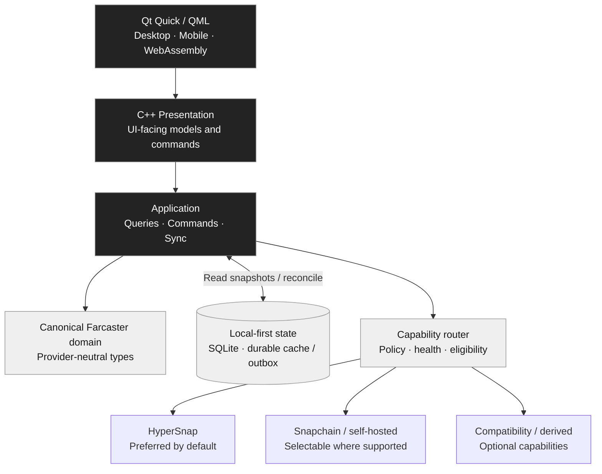

<div align="center">
  
  <h1>GenyCaster</h1>
  <p><strong>Native by design. Local-first by default. Farcaster without provider lock-in.</strong></p>
  <p>A cross-platform, protocol-aware social client built with Modern C++ and Qt Quick.</p>
  <p>
    <a href="https://genycaster.xyz">Website</a> ·
    <a href="docs/ARCHITECTURE.md">Architecture</a> ·
    <a href="docs/PERFORMANCE.md">Performance</a> ·
    <a href="CONTRIBUTING.md">Contributing</a> ·
    <a href="SECURITY.md">Security</a>
  </p>
  <p>
    
    
    
    
    
  </p>
</div>

> **Beta software.** GenyCaster is under active development. Support and completeness differ across platforms and selected network capabilities; it is not a security-audited, production-certified wallet. The release identifier `rc1` describes packaging, not a claim of stable readiness.

## The idea

**One client. Multiple protocol routes. One coherent user experience.**

GenyCaster is not a website wrapped in a desktop window. Its domain model, protocol operations, routing, persistence and application logic are implemented in a shared C++ core. Qt Quick presents that state across desktop, mobile and WebAssembly targets.

Its defining choices are architectural rather than cosmetic:

| Native-first | Local-first | Capability-routed | Secure boundaries |
|:--|:--|:--|:--|
| Shared C++26 application core, adaptive Qt Quick UI | Cached state renders immediately; network work reconciles in the background | **HyperSnap preferred**; Snapchain and compatible nodes selectable where supported | Authentication, custody, protocol signing and transport are separate authorities |

## Architecture at a glance



**Read path:** cached snapshot → UI immediately → routed background refresh → canonical reconciliation → updated snapshot.

**Write path (when enabled):** user intent → canonical message → authorized signer → durable outbox → provider transport → confirmation/reconciliation. Sign-in does **not** itself authorize a protocol write.

For the full module graph, provider selection, trust boundaries and native/browser differences, see **[Architecture](docs/ARCHITECTURE.md)**. For the original architectural invariants, see [docs/00](docs/00-architecture-overview.md) and the [architecture decisions](docs/adr/).

## What GenyCaster supports

| Surface | Capabilities |
|---|---|
| **Social** | Casts, threads, replies, quotes, recasts, likes, follows, profiles, channels, notifications and search |
| **Discovery** | Following, Explorer, content topics, channel discovery and provider-backed feeds |
| **Media** | Image and video embeds, rich link previews, cast references, image galleries and upload flows where available |
| **Identity & interaction** | Guest reads, Farcaster-linked account authentication, scoped signer authorization, multi-node configuration |
| **Your workspace** | Bookmarks and collections, profile extras, status, preferences, localized settings and optional account-backed extensions |
| **Mini Apps** | Embedded Mini App surfaces and permission-mediated wallet interactions where supported by the target runtime |
| **Experience** | Adaptive desktop/mobile layouts, light/dark appearances, 12 translation catalogs, RTL-aware content and regional formatting |

**Availability is capability- and platform-dependent.** Not every feature is enabled in every build. In particular, native secure storage and browser wallet interactions have distinct implementations and approval boundaries; WebAssembly is not equivalent to a privileged native process. See [Security](SECURITY.md) and [Platform and build notes](ci/README.md).

## The technology

| Layer | Implementation |
|---|---|
| Core | **Modern C++26**, project-owned named modules, RAII, explicit ownership and typed failures |
| UI | **Qt 6.12 / Qt Quick**, native graphics integration and platform-adaptive QML |
| State | **SQLite**, durable local cache, incremental snapshots and restart-safe write outbox |
| Networking | Qt Network / platform adapters and independent capability routes |
| Targets | macOS, Windows, Linux, Android, iOS and WebAssembly build configurations |
| Protocols | Farcaster canonical entities and messages; HyperSnap-first policy; configurable Snapchain/compatible routes |
| Optional services | Account data and product extensions, authentication and media gateways, kept outside the canonical protocol domain |

**Rendering:** production Qt Quick uses the platform's graphics API when available (for example Metal, Direct3D or OpenGL; WebGL on WebAssembly). `QT_QUICK_BACKEND=software` is used in selected **headless test** configurations, not as the shipping renderer policy.

## Performance: measured, not assumed

GenyCaster is designed for responsive timelines: UI-independent network/database work, local snapshots, incremental model updates, reuse of rich delegates and controlled media loading. These mechanisms are implemented to *reduce work*, but **C++ or native rendering alone does not prove a speed advantage**.

| Benchmark | GenyCaster | Other Farcaster clients |
|---|---|---|
| Cold-start to usable feed | Not yet published | Not yet measured under matching conditions |
| Warm-start to cached content | Not yet published | Not yet measured under matching conditions |
| Scroll frame time (p50 / p95 / p99) | Not yet published | Not yet measured under matching conditions |
| Peak memory and steady-state cache | Not yet published | Not yet measured under matching conditions |
| Time to first visible media | Not yet published | Not yet measured under matching conditions |

**No fabricated speedup percentages.** A fair comparison requires the same device, workload, account/feed, network, cache state, display refresh rate and sampling method. The published [Performance & benchmark protocol](docs/PERFORMANCE.md) defines the metrics, experiment design, result format and evidence required before numbers appear here.

## Build from source

The project uses **CMake 3.30+** and **Qt 6.12** for the graphical client, with a C++26-capable toolchain and Ninja. CI pins its own compatible toolchains; ordinary development machines must supply their supported Qt/compiler dependencies.

For a provider-free core build:

```bash
cmake --preset core-debug
cmake --build --preset core-debug
ctest --preset core-debug --output-on-failure
```

For a native Qt UI configuration:

```bash
cmake --preset ui-debug
cmake --build --preset ui-debug
ctest --preset ui-debug --output-on-failure
```

A version-pinned `ui-qt612-debug` configuration also exists for the Linux build environment documented in [Build profiles](docs/10-build-deployment-profiles.md). Read [CI and platform prerequisites](ci/README.md) before cross-compiling Android, iOS or WebAssembly; the browser target uses a matching Qt/Emscripten toolchain and has its own deployment process. Compiling does not imply that platform-specific signer, media or network acceptance has passed.

## Repository map

```text
src/         Protocol-independent domain, application, capabilities, routing and adapters
ui/          Qt Quick shell, native entry points, media and WebAssembly host
services/    Optional product and gateway services, independently deployed
tests/       Unit, contract, UI and regression tests
ci/          Verification, cross-platform packaging and release tooling
cmake/       Toolchain and build configuration helpers
docs/        Architecture, security and implementation references
```

## Documentation and community

| Start here | Purpose |
|---|---|
| [Documentation index](docs/README.md) | Curated entry points and historical/reference guide navigation |
| [Architecture](docs/ARCHITECTURE.md) | System graph, read/write pipelines, routing and trust boundaries |
| [Performance](docs/PERFORMANCE.md) | Benchmark protocol, measurement criteria and comparison rules |
| [Engineering rules](AGENTS.md) | Modern C++, module architecture, coding and verification constraints |
| [Build and delivery](ci/README.md) | Supported build profiles, CI and packaging |
| [Architecture decisions](docs/adr/) | Design rationale and invariants |
| [Contributing](CONTRIBUTING.md) | Contribution process, developer setup and test expectations |
| [Security policy](SECURITY.md) | Private vulnerability reporting and security boundaries |
| [Changelog](CHANGELOG.md) | Release history entry point |

GenyCaster is **GPL-3.0-only** for its original source code. Third-party assets and dependencies remain under their respective licenses; see [LICENSE](LICENSE) and [Third-party notices](THIRD_PARTY_NOTICES.md). The GenyCaster and Genyleap names and marks are not granted as trademarks by the software license.

---

<div align="center">
  <strong>GenyCaster</strong> — built for a native, local-first and provider-independent social experience.<br/>
  <sub>© 2025–2026 Genyleap · Beta</sub>
</div>
