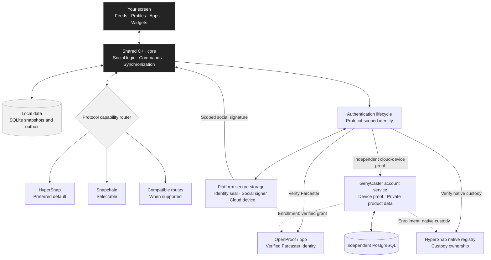

<div align="center">
  
  <h1>GenyCaster</h1>
  <p><strong>A native, local-first decentralized social experience.</strong></p>
  <p>One shared Modern C++ core. Multiple protocol routes. A consistent experience across devices.</p>
  <p>
    <a href="docs/FEATURES.md">Features</a> ·
    <a href="docs/ARCHITECTURE.md">Architecture</a> ·
    <a href="docs/12-roadmap.md">Roadmap</a> ·
    <a href="docs/PERFORMANCE.md">Performance</a> ·
    <a href="CONTRIBUTING.md">Contribute</a>
  </p>
  <p>
    
    
    
    
  </p>
</div>

## Overview

**GenyCaster** brings Farcaster conversations, discovery, media, apps and personal context into one cross-platform client. Its **shared Modern C++ core** handles protocol operations, state, synchronization and routing. **Qt Quick** provides adaptive desktop, mobile and WebAssembly interfaces. **Internationalization and localization (i18n/l10n)** let people independently choose their interface language, regional conventions, calendar and time zone rather than tying every preference to one country.

**Identity and account ownership:** GenyCaster uses [OpenProof](https://github.com/genyleap/openproof) (the independent `opp` identity service, configured at `https://openproof.genyleap.com`) for account authentication and verified Farcaster connections. HyperSnap-native identities are verified separately against the native custody registry. GenyCaster separates device-local identity continuity, protocol signing and private-cloud device authorization; its account service stores product data in an independent PostgreSQL database. Neither a remembered identity nor a social signer grants unrestricted cloud access. [Architecture and service dependencies](docs/OPENPROOF_AND_SERVICES.md).

The product follows four principles:

| Native rendering | Local-first continuity | Protocol choice | Scoped authorization |
|---|---|---|---|
| Native Qt Quick scene graph and shared C++ core | Cached social data can appear before a network refresh | HyperSnap preferred; configurable Snapchain and compatible routes | Authentication, protocol signing and Mini App wallet access stay distinct |

GenyCaster is in **Beta**. Some capabilities depend on the target platform, selected node, a verified account or an optional product service.

## Architecture in one view

The simplest way to understand GenyCaster is to follow a read: **the interface asks the application core for a feed; the core shows available local data, then refreshes through an eligible protocol route.**



**Reads:** show a cached snapshot if available → refresh from a supported node → reconcile and update the view.

**Writes:** user action → check account and signer permission → create a canonical protocol message → persist and submit safely → confirm the result.

**Independent responsibilities:** Farcaster protocol nodes determine canonical social messages; OpenProof provides authenticated account identity and verifies linked Farcaster connections; the GenyCaster account service stores product-specific extras in its own PostgreSQL database. An OpenProof login does not itself authorize a protocol signature, and a guest protocol read does not require the account database.

The [Architecture Guide](docs/ARCHITECTURE.md) explains each layer, provider routing, read/write flow, local storage and security boundaries in more detail.

## The experience

| Area | Capabilities and current scope |
|---|---|
| **Social** | Casts, replies, threads, quotes, reactions, follows, profiles, channels and notifications |
| **Explore** | Feeds, discovery, search, channels and topics, depending on selected provider capabilities |
| **Media** | Images, galleries, video, rich previews and supported uploads |
| **Mini Apps** | Discovery, saved apps and embedded sessions; wallet support varies by runtime and requires approval |
| **Native Apps** | **Concept** — a dedicated Apps category is present, but its runtime/catalog is Coming Soon |
| **Personal workspace** | Bookmarks, collections, preferences, profile extras and user status where supported |
| **Widgets** | Reorderable **Assets, GenyPulse, Calendar, Market and Suggestions** widgets in a context rail or mobile drawer |
| **Internationalization & localization (i18n/l10n)** | Twelve UI languages, automatic RTL/LTR layout, independently selectable region, calendar, time zone, timestamp style, localized numbers and currency presentation |
| **Appearance** | Light/dark themes and adaptive layouts |

### Your language, your regional conventions

Change the **interface language** without changing your **regional formats**. GenyCaster offers twelve embedded language catalogs and adapts text direction for RTL languages. Regional preferences independently control number and currency formatting, calendar systems (including Gregorian, Jalali and Islamic Civil), time zone, and smart, relative or calendar-based timestamp presentation. These are **display preferences**, not transformations of canonical Farcaster data or currency exchange rates.

See [Internationalization & Localization](docs/FEATURES.md#internationalization--localization-i18nl10n) for the available controls and additional calendar options.

### GENY ecosystem

GenyCaster includes optional integration with the **GENY token ecosystem on Base**. Its asset widget displays balances associated with verified Farcaster-linked wallets. **Geny Pro** is a 30-day subscription with an operator-controlled USD price paid in GENY on Base; eligibility is determined only by the account service's verified payment and subscription expiry, not by wallet holdings.

These integrations are distinct from Farcaster signing and core social reads. Displaying a balance does not grant Pro, and the application does not infer wallet permissions from token ownership.

See [Features](docs/FEATURES.md) for what is implemented, in development or conceptual, including GenyPulse and the Native Apps roadmap.

## Identity and server services

The [OpenProof project](https://github.com/genyleap/openproof) supplies the independently deployed **`opp`** identity server. The configured first-party identity origin is [openproof.genyleap.com](https://openproof.genyleap.com). It handles OAuth/device authentication and linked Farcaster identities; the C++ client integrates through `src/providers/openproof_auth/`. Separately, `services/account-sync/` exposes authenticated product data backed by its own PostgreSQL database; `services/media-gateway/` supports uploads and bounded browser-specific OpenProof flows. `services/quick-auth/` and `services/snapchain-gateway/` have narrower, optional responsibilities.

See [OpenProof & Server Services](docs/OPENPROOF_AND_SERVICES.md) for a service-by-service dependency map, authorization boundaries and source locations. OpenProof is a runtime service dependency for the configured account login, **not a linked dependency of the canonical Farcaster domain core**.

## Technology

| Component | Approach |
|---|---|
| Core | **Modern C++**, named modules, domain and capability contracts |
| Presentation | **Qt 6.12 / Qt Quick**, platform-adaptive QML |
| Local state | SQLite, incremental snapshots and a durable signed-write outbox |
| Protocol | Canonical Farcaster data with HyperSnap-first, configurable multi-node routing |
| Account identity | OpenProof (`opp`, verified Farcaster identity); separate HyperSnap native custody registry |
| Secure authorization | Independent identity seal, social signer and private-cloud device key; Apple Keychain, QtKeychain or origin-scoped WebCrypto/IndexedDB |
| Server-side product data | GenyCaster account API and its independent PostgreSQL storage; media gateway integrations |
| Targets | macOS, Windows, Linux, Android, iOS and **WebAssembly** build targets |
| Optional extensions | Mini Apps, context widgets, GENY product services, account-backed extras |

**Rendering:** Qt Quick selects an available platform graphics backend (for example Metal, Direct3D, OpenGL or browser WebGL). Selected headless tests set `QT_QUICK_BACKEND=software`; this is not a production-wide rendering policy. Actual acceleration depends on the device, driver and runtime.

## Performance and evidence

GenyCaster is designed around cached-first views, bounded background work, incremental UI updates and controlled media loading. These are implementation choices; **their end-user impact is measured separately**.

| Measurement | Public results |
|---|---|
| Cold start to usable feed | Not yet published |
| Warm start with cached content | Not yet published |
| Scroll frame time (p50 / p95 / p99) | Not yet published |
| Memory and first visible media | Not yet published |
| WebAssembly transfer and startup | Not yet published |

The [Performance Guide](docs/PERFORMANCE.md) defines reproducible workloads, measurement tools, and what evidence is required before numerical or comparative claims are made.

## Build

GenyCaster uses **CMake 3.30+**, **Ninja** and modern C++ features (C++23 and newer). The current CMake configuration explicitly selects **C++26**, so building this revision requires a **C++26-capable compiler**. The graphical client requires **Qt 6.12** and matching target-specific dependencies.

For core development:

```sh
cmake --preset core-debug
cmake --build --preset core-debug
ctest --preset core-debug --output-on-failure
```

For a configured native Qt environment:

```sh
cmake --preset ui-debug
cmake --build --preset ui-debug
ctest --preset ui-debug --output-on-failure
```

See [Build Profiles](docs/10-build-deployment-profiles.md), [Platform properties](properties/README.md), [CI](ci/README.md) and [WebAssembly](docs/webassembly.md) for target toolchains and limitations. A successful build is not by itself a platform release acceptance.

The root `flake.nix` is the NixOS package entrypoint (used by `nix build .#...` in CI), not a shared CMake configuration. The `ci/` directory holds source validation, asset generation, packaging, release-gate and deployment scripts used by `.github/workflows/ci.yml` and local development; it is not a separate app implementation.

## Project structure

```text
src/       Canonical domain, application, capability routing, adapters and storage
ui/        Native and WebAssembly presentation, apps, widgets and visual resources
properties/ Platform packaging metadata, manifests, native icons and PWA manifest
services/  Authenticated product state and gateway services (separate OpenProof identity)
tests/     Unit, contract, UI and regression tests
ci/        Toolchains, source checks, build and packaging verification
cmake/     Shared build helpers and isolated platform-specific configuration
docs/      Architecture, features, roadmap, reference guides and decisions
```

## Contribute

Start with [Contributing](CONTRIBUTING.md), the [Development Roadmap](docs/12-roadmap.md) and the [Documentation Index](docs/README.md). Report vulnerabilities privately using [Security](SECURITY.md). Release history and license details are in [Changelog](CHANGELOG.md), [LICENSE](LICENSE) and [Third-party notices](THIRD_PARTY_NOTICES.md).

GenyCaster's original code is **GPL-3.0-only**. Bundled third-party materials retain their own terms. GenyCaster and Genyleap marks remain under their respective trademark ownership.

<div align="center">
  <sub>GenyCaster · Beta · Native and local-first</sub>
</div>
