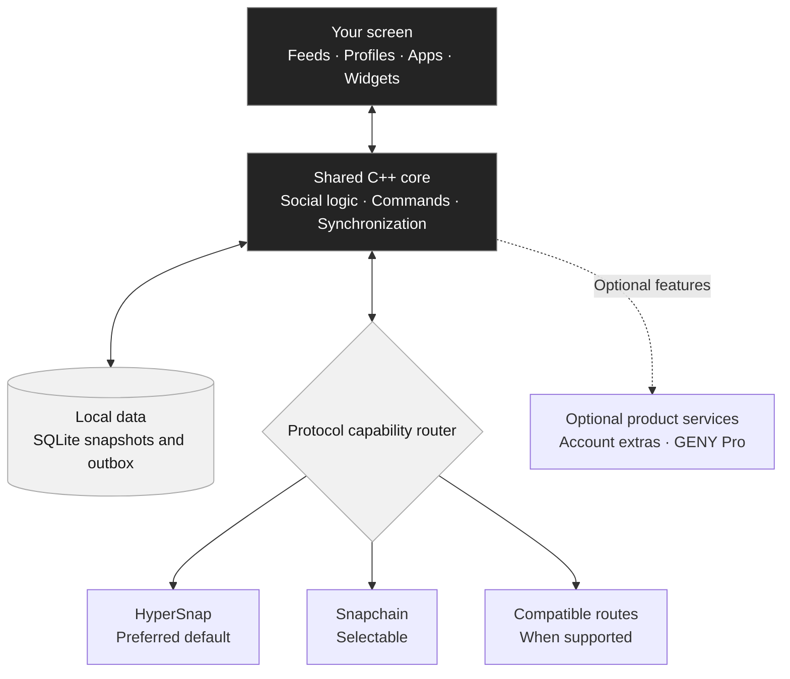

<div align="center">
  
  <h1>GenyCaster</h1>
  <p><strong>A native, local-first Farcaster experience.</strong></p>
  <p>One shared C++26 core. Multiple protocol routes. A consistent experience across devices.</p>
  <p>
    <a href="docs/FEATURES.md">Features</a> ·
    <a href="docs/ARCHITECTURE.md">Architecture</a> ·
    <a href="docs/12-roadmap.md">Roadmap</a> ·
    <a href="docs/PERFORMANCE.md">Performance</a> ·
    <a href="CONTRIBUTING.md">Contribute</a>
  </p>
  <p>
    
    
    
    
  </p>
</div>

## Overview

**GenyCaster** brings Farcaster conversations, discovery, media, apps and personal context into one cross-platform client. Its **shared Modern C++ core** handles protocol operations, state, synchronization and routing. **Qt Quick** provides adaptive desktop, mobile and WebAssembly interfaces.

The product follows four principles:

| Native rendering | Local-first continuity | Protocol choice | Scoped authorization |
|---|---|---|---|
| Native Qt Quick scene graph and shared C++ core | Cached social data can appear before a network refresh | HyperSnap preferred; configurable Snapchain and compatible routes | Authentication, protocol signing and Mini App wallet access stay distinct |

GenyCaster is in **Beta**. Some capabilities depend on the target platform, selected node, a verified account or an optional product service.

## Architecture in one view

The simplest way to understand GenyCaster is to follow a read: **the interface asks the application core for a feed; the core shows available local data, then refreshes through an eligible protocol route.**



**Reads:** show a cached snapshot if available → refresh from a supported node → reconcile and update the view.

**Writes:** user action → check account and signer permission → create a canonical protocol message → persist and submit safely → confirm the result.

**Independent responsibilities:** the Farcaster protocol determines canonical social messages; the optional GenyCaster services store product-specific extras such as bookmarks and GENY eligibility. Neither replaces the other.

The [Architecture Guide](docs/ARCHITECTURE.md) explains each layer, provider routing, read/write flow, local storage and security boundaries in more detail.

## The experience

| Area | Capabilities and current scope |
|---|---|
| **Social** | Casts, replies, threads, quotes, reactions, follows, profiles, channels and notifications |
| **Explore** | Feeds, discovery, search, channels and topics, depending on selected provider capabilities |
| **Media** | Images, galleries, video, rich previews and supported uploads |
| **Mini Apps** | Discovery, saved apps and embedded sessions; wallet support varies by runtime and requires approval |
| **Native Apps** | **Concept** — a dedicated Apps category is present, but its runtime/catalog is Coming Soon |
| **Personal workspace** | Bookmarks, collections, preferences, profile extras and user status where supported |
| **Widgets** | Reorderable **Assets, GenyPulse, Calendar, Market and Suggestions** widgets in a context rail or mobile drawer |
| **Languages and themes** | Twelve locale catalogs, RTL-aware presentation, light/dark themes and adaptive layouts |

### GENY ecosystem

GenyCaster includes optional integration with the **GENY token ecosystem on Base**. Its asset widget displays balances associated with verified Farcaster-linked wallets. **Geny Pro** eligibility is evaluated by the account service using verified wallet addresses and on-chain token holdings, with product capabilities and limits defined by server policy.

These integrations are distinct from Farcaster signing and core social reads. Displaying a balance does not grant Pro, and the application does not infer wallet permissions from token ownership.

See [Features](docs/FEATURES.md) for what is implemented, in development or conceptual, including GenyPulse and the Native Apps roadmap.

## Technology

| Component | Approach |
|---|---|
| Core | Modern **C++26**, named modules, domain and capability contracts |
| Presentation | **Qt 6.12 / Qt Quick**, platform-adaptive QML |
| Local state | SQLite, incremental snapshots and a durable signed-write outbox |
| Protocol | Canonical Farcaster data with HyperSnap-first, configurable multi-node routing |
| Targets | macOS, Windows, Linux, Android, iOS and **WebAssembly** build targets |
| Optional extensions | Mini Apps, context widgets, GENY product services, account-backed extras |

**Rendering:** Qt Quick selects an available platform graphics backend (for example Metal, Direct3D, OpenGL or browser WebGL). Selected headless tests set `QT_QUICK_BACKEND=software`; this is not a production-wide rendering policy. Actual acceleration depends on the device, driver and runtime.

## Performance and evidence

GenyCaster is designed around cached-first views, bounded background work, incremental UI updates and controlled media loading. These are implementation choices; **their end-user impact is measured separately**.

| Measurement | Public results |
|---|---|
| Cold start to usable feed | Not yet published |
| Warm start with cached content | Not yet published |
| Scroll frame time (p50 / p95 / p99) | Not yet published |
| Memory and first visible media | Not yet published |
| WebAssembly transfer and startup | Not yet published |

The [Performance Guide](docs/PERFORMANCE.md) defines reproducible workloads, measurement tools, and what evidence is required before numerical or comparative claims are made.

## Build

GenyCaster uses **CMake 3.30+** and **Ninja**, with a C++26-capable toolchain. The graphical client requires **Qt 6.12** and matching target-specific dependencies.

For core development:

```sh
cmake --preset core-debug
cmake --build --preset core-debug
ctest --preset core-debug --output-on-failure
```

For a configured native Qt environment:

```sh
cmake --preset ui-debug
cmake --build --preset ui-debug
ctest --preset ui-debug --output-on-failure
```

See [Build Profiles](docs/10-build-deployment-profiles.md), [CI](ci/README.md) and [WebAssembly](docs/webassembly.md) for target toolchains and limitations. A successful build is not by itself a platform release acceptance.

## Project structure

```text
src/       Canonical domain, application, capability routing, adapters and storage
ui/        Native and WebAssembly presentation, apps, widgets and visual resources
services/  Optional authenticated product and gateway services
tests/     Unit, contract, UI and regression tests
ci/        Toolchains, source checks, build and packaging verification
cmake/     Build helpers and platform configuration
docs/      Architecture, features, roadmap, reference guides and decisions
```

## Contribute

Start with [Contributing](CONTRIBUTING.md), the [Development Roadmap](docs/12-roadmap.md) and the [Documentation Index](docs/README.md). Report vulnerabilities privately using [Security](SECURITY.md). Release history and license details are in [Changelog](CHANGELOG.md), [LICENSE](LICENSE) and [Third-party notices](THIRD_PARTY_NOTICES.md).

GenyCaster's original code is **GPL-3.0-only**. Bundled third-party materials retain their own terms. GenyCaster and Genyleap marks remain under their respective trademark ownership.

<div align="center">
  <sub>GenyCaster · Beta · Native and local-first</sub>
</div>
