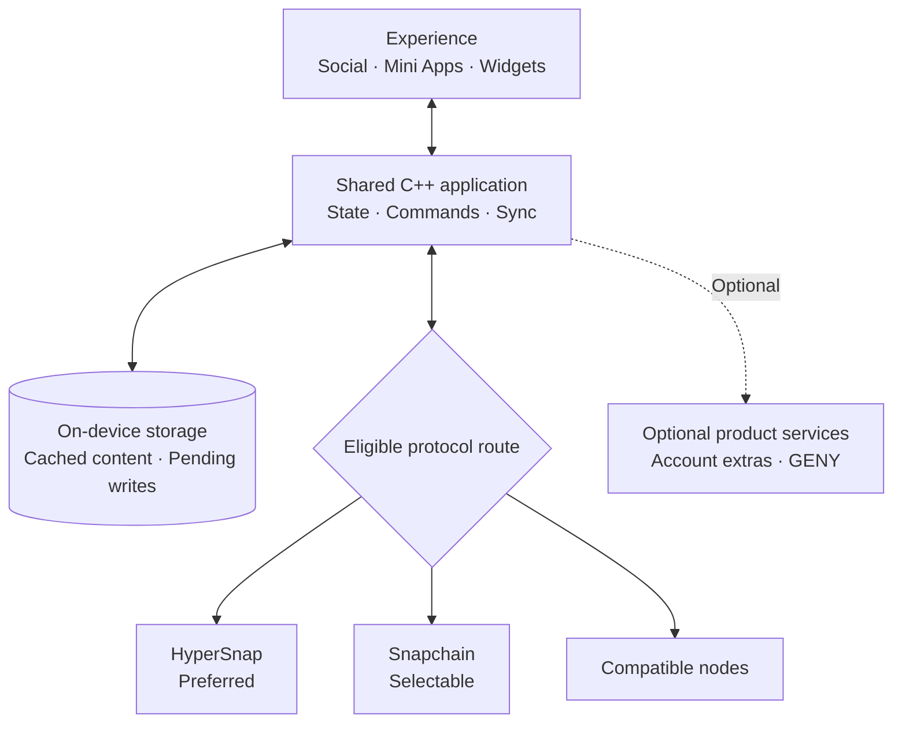
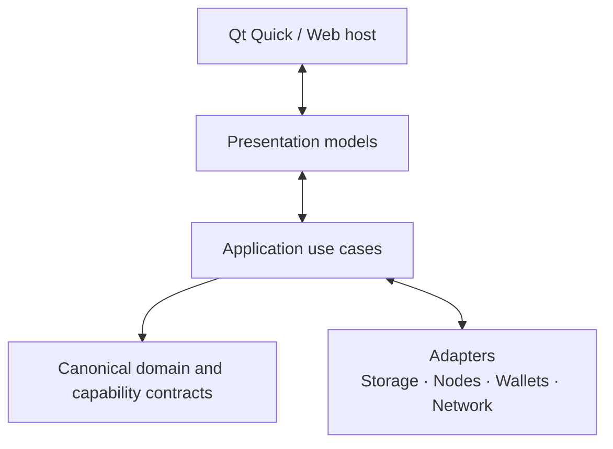
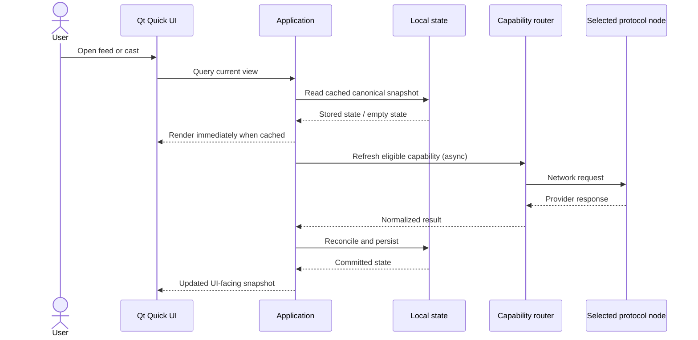
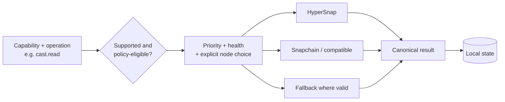
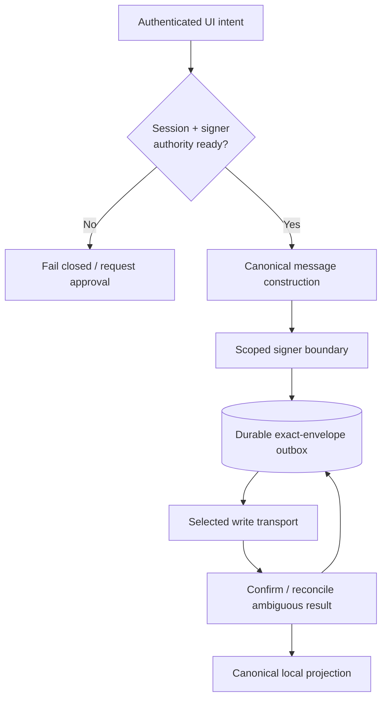

# Architecture — how GenyCaster works

GenyCaster combines three responsibilities: **the interface**, a **shared application core**, and **protocol/data providers**. Native and browser builds share the application core, while platform integrations adapt to their security capabilities.

## Architecture at a glance

When a feed opens, the application reads a local snapshot first, then refreshes through an eligible protocol provider. When a person interacts with a Cast, the application verifies the appropriate signer authority before submitting a canonical protocol message.



| Boundary | Responsibility |
|---|---|
| **Interface** | Feeds, conversations, profiles, Mini Apps, widgets and runtime i18n/l10n formatting |
| **Application and domain** | Canonical Farcaster operations, routing contracts and reconciliation |
| **On-device state** | Cached snapshots, preferences and durable write queue |
| **Capability router** | Select an eligible provider for each read or write |
| **Optional services** | Account extras, media gateways and verified GENY-related benefits |

**Capability routing** means profile reads, feed reads and signed message submissions may use different supported adapters. HyperSnap is the default preference, not a dependency of the domain.

## Contributor module view



The dependency direction is presentation → application → canonical domain/capability contracts. Qt, database details, raw network DTOs and provider-specific implementations remain in their owning adapters. See [Architecture Overview](00-architecture-overview.md), [Module Rules](03-dependency-and-module-rules.md), [Provider Routing](04-provider-boundary-and-routing.md) and [ADRs](adr/).

## Local-first read path



This is the *responsibility flow*, not a guarantee that every empty first-run screen has cached content. Offline mode retains what is available locally and does not fabricate remote state. Pagination and provider-specific cursors remain adapter-owned or are normalized into scoped application continuation state.

**Performance consequences:** native Qt UI input does not wait for a network round trip before rendering an existing local snapshot; expensive read and synchronization work is scheduled away from the GUI thread. See [Performance](PERFORMANCE.md).

## Capability-based routing

GenyCaster is **Farcaster-protocol-aware**, not locked to the protocol node selected today.

- **HyperSnap** is the preferred node/read policy in ordinary supported configurations.
- **Snapchain** and other compatible node routes are selectable where the operation and target build allow them.
- Selection is **per capability**: `cast.read`, `feed.following`, profile reads, signer registration and writes need not share one universal backend.
- Provider health, operation support, authentication requirements, error semantics and privacy/network policy determine eligibility.
- Compatibility features and derived product data are modeled as extensions; they must not redefine canonical Farcaster messages.
- Read failover is permitted only when semantics match. **Write failover is not a blind retry** because ambiguous completion can cause duplicates.



The distinction between protocol operations and derived services is documented in [Capability Taxonomy](02-capability-taxonomy.md), [Routing](04-provider-boundary-and-routing.md), and [Provider Affinity ADR](adr/0007-provider-affine-continuations.md). A self-hosted deployment can compose a different set of eligible adapters; support is not assumed for features whose adapters are missing.

## Signing and trust boundaries



**Separate trust authorities:** four distinct identities/privileges must not be conflated:

| Boundary | Responsibility | Must not imply |
|---|---|---|
| Account authentication | Session identity and a linked Farcaster FID | Permission to sign arbitrary protocol messages |
| Custody wallet | Approval of scoped signer registration where required | A reusable unscoped Mini App wallet grant |
| Protocol signer | Canonical signed Farcaster messages with authorized scopes | Authority for unrelated networks or dApps |
| Provider transport | Submit, read back and reconcile messages | Control of the private signer key |

Native signer material belongs in an OS-backed secure vault. Private key bytes must not enter QML or ordinary SQLite state. The WebAssembly target has a **different browser capability model**: compiled-out native vault capabilities cannot be inferred from the desktop implementation. Mini Apps require origin-scoped permission checks and browser-specific validation. Never substitute local storage or a persistent "approved" UI flag for cryptographic authorization.

Related references: [Security and Signing](08-security-auth-and-signing.md), [Outbox ADR](adr/0010-durable-local-outbox.md), [Write Idempotency ADR](adr/0011-write-idempotency-strategy.md), [SECURITY.md](../SECURITY.md).

## Rendering and threading

```text
Qt GUI thread             input · layout · small presentation updates
Qt Scene Graph / RHI      visual scene rendering, GPU backend where available
Background executors      network · cache I/O · normalization · reconciliation
OS secure storage         signer material; isolated behind a native adapter
```

Qt Quick's graphics API is selected for the platform and driver (Metal, Direct3D, OpenGL, and WebGL-backed browser contexts as applicable). `QT_QUICK_BACKEND=software` appears in specific headless test environment settings in `tests/ui/CMakeLists.txt`; this is not a production-wide renderer assignment. Do not claim hardware acceleration solely because the build has WebGL support: inspect runtime `QQuickWindow::rendererInterface()->graphicsApi()` and collect frame-time measurements.

**UI invariants:** QML does not perform database I/O, cryptographic signing, provider HTTP/JSON parsing or large model rebuilds on the presentation hot path. Expensive media admission and cached timeline reconciliation are asynchronous. [UI performance contract](14-performance-and-ui-runtime.md).

## Optional product services

The `services/` tree contains independent account/product and gateway boundaries: account synchronization for GenyCaster-specific metadata, media handling, authentication integrations, and a Snapchain gateway. These services are **not** the canonical Farcaster protocol itself and must not be represented as required for ordinary provider-independent domain logic.

A source-code build is not equivalent to an authorized production deployment. Credentials, App-FID attestation keys, database access and service-side controls remain operator-managed. Review individual service READMEs and [SECURITY.md](../SECURITY.md) before exposing endpoints.

## Repository guide

| Area | Start with |
|---|---|
| Domain, types, protocol | `src/domain/`, `src/capabilities/` |
| Commands, read models and sync | `src/application/` |
| Network routing and adapters | `src/providers/`, `src/transport/` |
| Persistence and migrations | `src/storage/` |
| Qt UI / native entry points | `ui/components/`, `ui/app/` |
| WebAssembly runtime | `ui/wasm/`, [WebAssembly](webassembly.md) |
| Build configurations | `CMakePresets.json`, [Build profiles](10-build-deployment-profiles.md) |
| Tests and verification | `tests/`, [CI](../ci/README.md) |

## Engineering principles

1. A provider can be replaced without redesigning the domain/application/UI contract.
2. Canonical protocol state and derived product state are separate.
3. A valid cached view renders without requiring a fresh network response.
4. Sign-in, wallet authorization and canonical signer provisioning are different operations.
5. Outgoing signed writes are scoped, durable and reconciled after ambiguous results.
6. Optional features do not become mandatory dependencies of core social capabilities.
7. A platform may **fail closed** on unsupported security capabilities rather than weaken their contract.
8. Claims of performance or security require measured evidence, platform-specific tests and explicit scope.

The detailed normative documents in `docs/` and `AGENTS.md` supersede simplified overview diagrams wherever implementation conditions or platform constraints differ.
