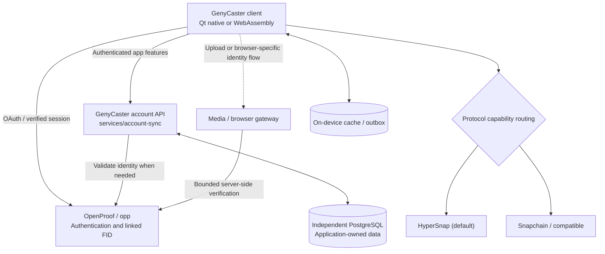

# Identity and server services: OpenProof + GenyCaster

GenyCaster has **two separate data authorities**: OpenProof authenticates
people and proves linked identities; GenyCaster owns its own application
data. Neither is a replacement for the Farcaster protocol or the selected
HyperSnap/Snapchain node.

## OpenProof: account identity and connection authority

[OpenProof](https://github.com/genyleap/openproof) is Genyleap's independent,
self-hostable identity platform. Its production server executable is named
[`opp`](https://github.com/genyleap/openproof/tree/main/apps/opp). The
configured identity origin in current GenyCaster deployments is
[`https://openproof.genyleap.com`](https://openproof.genyleap.com);
operators can configure their own trusted issuer where supported.

OpenProof provides account login and identity proofs, OAuth/OIDC with PKCE
and device authorization, account connections and verification of linked
Farcaster identity (FID). The native GenyCaster adapter is implemented in
`src/providers/openproof_auth/`. Browser and service integration boundaries
include `ui/app/browser_openproof_auth.cpp` and
`services/media-gateway/browser_farcaster_auth.mjs`.

The first-party Genyleap/OpenProof account route and the direct
“Sign in with Farcaster” onboarding route ultimately resolve a
**verified OpenProof-backed identity linked to a Farcaster FID**.
A successful login does not grant a protocol signer, custody access,
Mini App wallet permission or automatic publishing authority.

OpenProof is an **external runtime service and repository**, not a C++
module statically embedded in the GenyCaster executable. A running OpenProof
instance is required for the configured OpenProof-backed login and
connection-management flows. Guest/public protocol reads do not depend on
OpenProof being available.

## GenyCaster-owned account data and PostgreSQL

`services/account-sync/` implements the GenyCaster account API. Its PostgreSQL datastore is logically and operationally
**independent of OpenProof's database**. Production uses a restricted application database role and a server-only `GENYCASTER_DATABASE_URL`;
credentials never belong in client files, QML, WASM or source control.

The application database persists features Farcaster does not canonically
represent: bookmarks and collections, profile extras, user status, private
drafts, notification-read state, app-defined topics, account sessions and
optional product entitlements. Account ownership must be resolved from
server-validated credentials and an authenticated linked FID, never a raw
client-submitted identity. Migrations and schema live in
`services/account-sync/migrations/`.

The local SQLite cache/outbox is a responsive/offline client store, **not**
a separate user-operated sync system. App-owned edits reconcile
automatically with the authenticated account service. Outages must not
silently report remote writes as persisted.

## Service ownership map

| Boundary | Implementation | Role | Availability |
|---|---|---|---|
| OpenProof identity server | [genyleap/openproof](https://github.com/genyleap/openproof), `apps/opp/` | OAuth/device sign-in, account identity, linked identities, session validation | Required for configured OpenProof authentication |
| GenyCaster account service | [`services/account-sync/`](../services/account-sync/) | Account-specific state, product policy and private PostgreSQL persistence | Needed for account-backed extras, not for public protocol reads |
| GenyCaster media/browser gateway | [`services/media-gateway/`](../services/media-gateway/) | Bounded uploads, public media URLs and explicit browser/OpenProof verification proxy | Required by corresponding media/browser integrations |
| Protocol Quick Auth verifier | [`services/quick-auth/`](../services/quick-auth/) | Separately verifies Farcaster Mini App protocol-auth tokens | Optional; **not** an alternative OpenProof account login |
| Snapchain gateway | [`services/snapchain-gateway/`](../services/snapchain-gateway/) | Protocol transport/gateway where configured | Adapter-specific; not the only protocol route |
| Protocol nodes | Selected HyperSnap, Snapchain or compatible providers | Canonical casts, reactions, relations and protocol message submission | Capability-dependent; HyperSnap preferred |

## Trust and network flow

**Non-equivalence:** an OpenProof session is not a Farcaster
cryptographic signature; the GenyCaster product DB is not an
OpenProof credential database; the protocol node is not the GenyCaster
account service. Signer grants and Mini App wallet approvals remain
separate, scoped security operations.

## Configuration and evidence

Read [account service](../services/account-sync/README.md),
[media gateway](../services/media-gateway/README.md),
[identity/signing rules](08-security-auth-and-signing.md) and
[architecture decision 0015](adr/0015-openproof-connections-and-cloud-state.md)
for the exact security contracts. Backend service availability must be
monitored and tested independently: source code does not prove a live service
is currently reachable, that its migrations are applied or that its
authentication is configured securely.

Only document public production origins as architectural references; do not
commit service passwords, OAuth client secrets, restricted database URLs,
temporary authorization tickets or private deployment topology.
