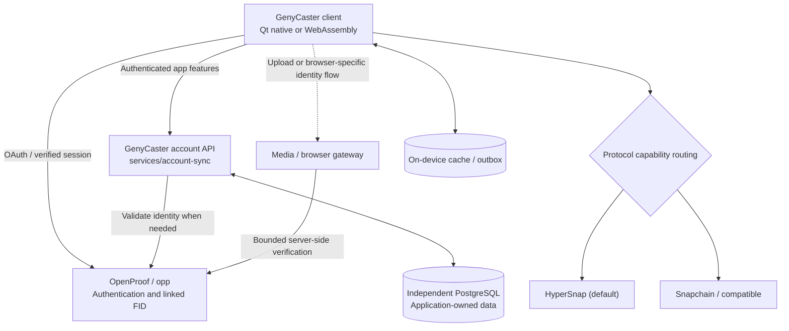

# Identity and server services: OpenProof + GenyCaster

GenyCaster has **two separate data authorities**: OpenProof authenticates
people and proves linked identities; GenyCaster owns its own application
data. Neither is a replacement for the Farcaster protocol or the selected
HyperSnap/Snapchain node.

## OpenProof: account identity and connection authority

[OpenProof](https://github.com/genyleap/openproof) is Genyleap's independent,
self-hostable identity platform. Its production server executable is named
[`opp`](https://github.com/genyleap/openproof/tree/main/apps/opp). The
configured identity origin in current GenyCaster deployments is
[`https://openproof.genyleap.com`](https://openproof.genyleap.com);
operators can configure their own trusted issuer where supported.

OpenProof provides account login and identity proofs, OAuth/OIDC with PKCE
and device authorization, account connections and verification of linked
Farcaster identity (FID). The native GenyCaster adapter is implemented in
`src/providers/openproof_auth/`. Browser and service integration boundaries
include `ui/app/identity/browser_auth.cpp` and
`services/media-gateway/browser_farcaster_auth.mjs`.

The first-party Genyleap/OpenProof account route and the **direct
OpenProof-backed** “Sign in with Farcaster” authentication route resolve a
**verified OpenProof-backed identity linked to a Farcaster FID**, provided the
issuer's ceremony completes successfully. In native builds with OpenProof
enabled, both buttons now use the OpenProof adapter. In the browser, the
corresponding routes use the browser OpenProof gateway. A successful login
does not grant a protocol signer, custody access, Mini App wallet permission
or automatic publishing authority.

### Native account convergence after confirmed registration — November 2026

GenyCaster now starts a bounded, separately verified OpenProof ceremony **after**
the native registry has confirmed a new custody-controlled FID and its
protocol-only session was saved. The protocol registration is **never**
resubmitted as part of the OpenProof ceremony or a Retry action.

- **New Farcaster FID:** reuse the existing trusted browser Farcaster
  recovery gateway. Native C++ checks the trusted origin, the exact
  Optimism FID, the confirmed custody address and signed EIP-191 challenge.
  OPP verifies the proof using existing Farcaster SIWF support and returns
  the canonical identity, confirmed FID and one-use account ticket.
  Only then is a canonical OpenProof-backed session saved and the account
  ticket handed to the account service. An existing OPP subject is reused
  when the same Farcaster identity is already linked there.
- **New HyperSnap Native FID:** OPP has **no HyperSnap registry verifier**.
  Existing ethereum-wallet SIWE can independently establish the wallet's
  canonical OPP account, subject to the configured provider policy. Native
  C++ signs a domain/address/chain/statement-bound SIWE challenge; afterward
  it verifies the returned OPP profile and matching wallet connection.
  The HyperSnap session issuer stays hypersnap:native-registry. **This does
  not verify or link the Native FID to the OPP subject**, grant a Farcaster
  account capability or enable HyperSnap-FID-based OPP SSO.
- **Existing Genyleap accounts:** an already-linked Farcaster identity or
  wallet resolves its existing canonical OPP subject. If the user already
  has an account authenticated by a different provider, do not silently
  merge it with an unrelated new SIWE account. Linking requires explicit
  existing-account authentication and a separate ownership-checked OPP
  connection ceremony. Cross-account merge remains out of scope.
- **Reliability:** OPP failures preserve the confirmed protocol FID, wallet,
  writer and signer. Retry repeats only the identity challenge, not the
  registry write. Sign-out and FID changes invalidate in-flight results.
  BIP39 derivation and signature happen in C++ workers; no mnemonic is
  exposed through Qt properties, HTTP, QML or JavaScript.
- **Platform scope:** the native onboarding integration is compiled only
  when custody registration and OPP are available. WebAssembly retains
  browser OpenProof device/Farcaster flows. Device-only recovery is not
  the same as verified OpenProof enrollment.

**Remaining:** a verified OPP HyperSnap Native FID provider/linker; an
explicit existing-account-first wallet linking choice; restart/key-lost
resumption; and real production and cross-platform end-to-end qualification.
A wallet account in OPP must never be labeled a verified HyperSnap FID link.

Browser/WASM OpenProof device/Farcaster sign-in is OpenProof-backed only after
the real issuer grants a subject and an authenticated connection. The
`genycaster:device-local` browser recovery path deliberately does **not**
constitute a renewed OpenProof login or account enrollment. In current
WebAssembly builds, native custody registration is compiled out; do not infer
that a successful browser sign-in tested native protocol registration.

The current OPP Web3 login API implements `farcaster` (SIWF, Optimism
IdRegistry) and `ethereum-wallet` (SIWE). It has **no HyperSnap-native
provider/connection verifier**. An EVM address in OPP alone must not be
treated as verified ownership of a HyperSnap FID, nor must a protocol FID be
submitted as an unauthenticated account-creation claim.

**Required before claiming automatic OpenProof enrollment for every signup:**

1. OPP must accept a fresh, domain-bound, single-use custody proof for a
   HyperSnap-native FID, verify the FID-to-custody relationship against a
   fixed trusted HyperSnap registry, and durably link that exact
   `(protocol, fid)` tuple to a canonical OPP subject. Farcaster's existing
   SIWF/Optimism verifier may be reused for its own FIDs only.
2. After a protocol registration is **confirmed** (not merely submitted),
   a shared native/browser onboarding coordinator must complete the appropriate
   OPP ceremony with user consent, then verify the resulting subject and
   linked protocol FID before reporting **account registration complete**.
   It must never reuse a protocol KEY_ADD signature, handle mnemonic words
   in QML, or silently enroll by an unverified public FID.
3. Interrupted or offline OPP enrollment must have a resumable, idempotent
   pending state; it must not fabricate a synced account, rotate the
   custody key, repeat on-chain registration, or change the selected writer.
   Existing protocol-only sessions need a verified migration/linking path.
4. The matrix of macOS, Windows, Linux, Android, iOS and WebAssembly must be
   acceptance-tested for both supported protocols and for new, resumed and
   recovered identities. **No all-platform guarantee exists yet.**

This is an explicit **open product/security integration gap**, not a missing
background telemetry call. OPP authentication, protocol registration, app-owned
account data and device signer authorization remain separate trust domains.

OpenProof is an **external runtime service and repository**, not a C++
module statically embedded in the GenyCaster executable. A running OpenProof
instance is required for the configured OpenProof-backed login and
connection-management flows. Guest/public protocol reads do not depend on
OpenProof being available.

## GenyCaster-owned account data and PostgreSQL

`services/account-sync/` implements the GenyCaster account API. Its PostgreSQL datastore is logically and operationally
**independent of OpenProof's database**. Production uses a restricted application database role and a server-only `GENYCASTER_DATABASE_URL`;
credentials never belong in client files, QML, WASM or source control.

The application database persists features Farcaster does not canonically
represent: bookmarks and collections, profile extras, user status, private
drafts, notification-read state, app-defined topics, account sessions and
optional product entitlements. Account ownership must be resolved from
server-validated credentials and an authenticated linked FID, never a raw
client-submitted identity. Migrations and schema live in
`services/account-sync/migrations/`.

### Protocol-scoped account-session rollout (security contract)

The app-owned `GET /api/v1/cloud/session` and successful
`POST /api/v1/cloud/session/proof` return the verified session tuple
`{fid, issuer, subject, csrf_token}`. The `fid` is a **decimal string**,
not a JavaScript numeric authority. Browser custody sign-in requires the
configured OpenProof `issuer` and exact `subject=farcaster:<fid>`.
Native Qt allows that Farcaster tuple or a separately verified
`issuer=hypersnap:native-registry` +
`subject=hypersnap:<fid>` tuple with native FIDs beginning at `2^32`.
A numeric FID match **alone** cannot establish an authenticated session
or imply that the native identity has been linked to an OpenProof account.

**Deployment ordering:** publish the updated
`services/account-sync/` API before distributing clients that enforce the
tuple. Older service responses omit issuer/subject, so new clients
deliberately **fail closed** instead of accepting an ambiguous cookie.
The server's response-field addition is backward compatible with
existing clients. Do not silently relax client checks to compensate for
a stale deployment. Verify fresh proof, cookie restore, sign-out and
cross-protocol account switching in a restricted staging environment,
then carry out a controlled backend-first rollout. Production service
mutation or live paid onboarding was **not performed** by this source
change. This cookie policy is not the missing OpenProof native-FID verifier
required by [GenyCaster #4](https://github.com/genyleap/genycaster/issues/4)
and [OpenProof #52](https://github.com/genyleap/openproof/issues/52).

The local SQLite cache/outbox is a responsive/offline client store, **not**
a separate user-operated sync system. App-owned edits reconcile
automatically with the authenticated account service. Outages must not
silently report remote writes as persisted.

## Service ownership map

| Boundary | Implementation | Role | Availability |
|---|---|---|---|
| OpenProof identity server | [genyleap/openproof](https://github.com/genyleap/openproof), `apps/opp/` | OAuth/device sign-in, account identity, linked identities, session validation | Required for configured OpenProof authentication |
| GenyCaster account service | [`services/account-sync/`](../services/account-sync/) | Account-specific state, product policy and private PostgreSQL persistence | Needed for account-backed extras, not for public protocol reads |
| GenyCaster media/browser gateway | [`services/media-gateway/`](../services/media-gateway/) | Bounded uploads, public media URLs and explicit browser/OpenProof verification proxy | Required by corresponding media/browser integrations |
| Protocol Quick Auth verifier | [`services/quick-auth/`](../services/quick-auth/) | Separately verifies Farcaster Mini App protocol-auth tokens | Optional; **not** an alternative OpenProof account login |
| Snapchain gateway | [`services/snapchain-gateway/`](../services/snapchain-gateway/) | Protocol transport/gateway where configured | Adapter-specific; not the only protocol route |
| Protocol nodes | Selected HyperSnap, Snapchain or compatible providers | Canonical casts, reactions, relations and protocol message submission | Capability-dependent; HyperSnap preferred |

## Trust and network flow

**Non-equivalence:** an OpenProof session is not a Farcaster
cryptographic signature; the GenyCaster product DB is not an
OpenProof credential database; the protocol node is not the GenyCaster
account service. Signer grants and Mini App wallet approvals remain
separate, scoped security operations.

## Configuration and evidence

Read [account service](../services/account-sync/README.md),
[media gateway](../services/media-gateway/README.md),
[identity/signing rules](08-security-auth-and-signing.md) and
[architecture decision 0015](adr/0015-openproof-connections-and-cloud-state.md)
for the exact security contracts. Backend service availability must be
monitored and tested independently: source code does not prove a live service
is currently reachable, that its migrations are applied or that its
authentication is configured securely.

Only document public production origins as architectural references; do not
commit service passwords, OAuth client secrets, restricted database URLs,
temporary authorization tickets or private deployment topology.
